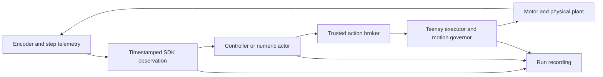

# How the experiment works

A motor moves a cart horizontally. A freely rotating pendulum pivots on the cart.
The challenge is to bring the pendulum from hanging down to upright, then keep it
there without running out of rail. Moving the pivot accelerates the pendulum; the
controller chooses cart acceleration rather than directly pushing the pole.
Angles in the SDK's upright-referenced frame are zero upright and ±π hanging.
Positions are metres, angles radians, time nanoseconds in observations, and
acceleration requests metres per second squared. Do not mix those values with
millimetres, encoder counts or wall-clock timestamps.

## Two ways to choose motion

**Physics-based control** uses an effective pendulum model to estimate energy.
Swing-up adds and removes energy in phase with motion. Near upright, approach and
capture logic hand over to a stabilizing balance controller. Cart-centering terms
keep the operating point away from the ends. Rail recovery, spin checks and motion
limits are essential parts of the complete behavior, not just the balance gains.
The firmware runs the established AUTO controller locally at high rate. The SDK
includes its native C++ math and Python reference implementation so developers can
inspect and exercise the same design. External Python execution additionally has
sensor age, filtering, process scheduling, transport and action-deadline effects.
Identical equations alone do not make these two closed loops identical.

**Learned control** evaluates a compact neural network trained by PPO. It receives
state, validity and age features, then emits an acceleration demand. The provided
numeric actors have a 21→64→64→1 network, two tanh hidden layers, a 100 Hz decision
rate and a 25 m/s² action scale. The runtime validates their schema and source
provenance; inference needs no executable checkpoint or PyTorch model deserializer.
The observation encoder and action scaling are part of the policy, not optional
preprocessing that can be changed without changing its meaning.

The policy's recorded executor parameters describe its training/deployment
contract. Physics-controller feedback gains do not become neural-network gains.
Console policy execution scopes applicable settings and restores previous settings;
compatibility checks still protect calibration, motion limits and source contracts.
An explicit console rail-tolerance setting is a bounded compatibility allowance,
not permission to move beyond the live rail.

## From a Python action to the motor

A controller implements `reset(session)` and `act(observation)`, returning
`Acceleration(value)` or `None`. Observations carry session, source, coordinate
frame, sequence, validity and timing. `None` does not renew an old physical action.
The trusted host validates demands and attaches authority/expiry; the board
independently enforces its limits, action lifetime and faults. Board faults stop
motion and require operator recovery. A submitted program has no serial port,
credential, direct homing call or authority to extend its run.

There are multiple clocks. A sensor's measurement time and availability time are
not the same thing, and camera frames arrive more slowly than encoder telemetry.
Use the supplied adapters and age checks rather than stripping source metadata or
pretending delayed observations are current. Step-derived cart position is an
estimate; lost motor steps are not measured cart displacement.

## Simulation and how we developed the system

The versioned `rig-calibrated-20261021-v1` profile combines a pendulum model with
an executor/motion governor, quantized/filtered encoder observations and latency.
Its nominal experiment uses 100 Hz decisions and a 1 kHz underlying executor/plant
cadence. The same source-explicit policy contract supports local simulation,
recorded replay and hardware submission. Replay feeds recorded observations into a
new controller; its new actions cannot change the already recorded trajectory.

We characterized passive and driven motion, compared predictions against fresh
measurements, built the executor/reference controller, then trained and exported
policies against governed simulation. The system-ID directory includes both the
useful fitted results and evidence of model mismatch. Some fits failed independent
validation. Consequently, the profile's name means that measurements informed it;
it does not mean complete identification or guaranteed sim-to-real transfer.

The earlier working policy learned a full-rotation recovery strategy. A later
experiment added domain randomization, energy/rail penalties and a full-rotation
constraint to encourage pumping swing-up. That campaign completed but did not meet
its controlled-swing objective. [The training report](TRAINING_STATUS.md) records
this negative result rather than promoting its last checkpoint.

Use simulation to develop source handling, compare policies and discover obvious
failures. Use held-out seeds and randomized settings to challenge a design. Physical
testing is still needed for actuator authority, real delay/jitter, encoder bias,
friction, backlash, lost steps and electrical faults. No simulator run grants
hardware acceptance.
