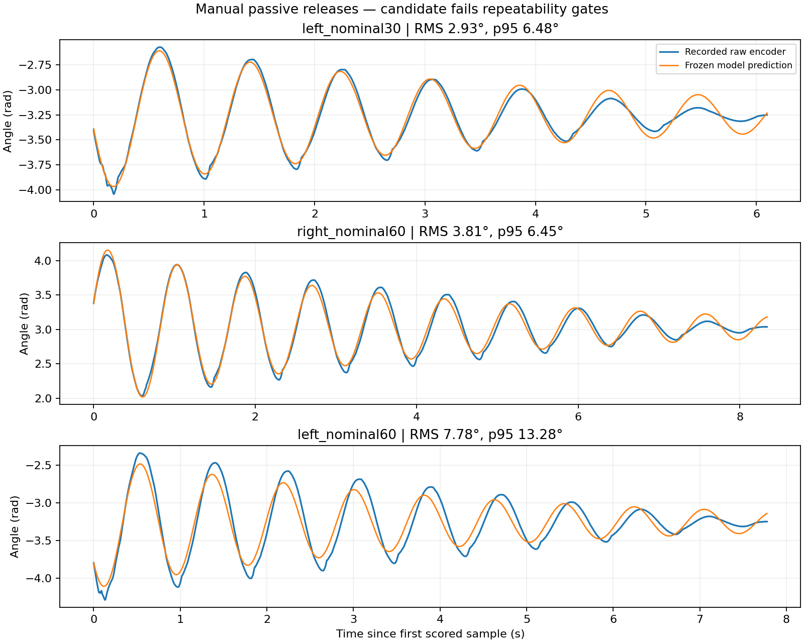
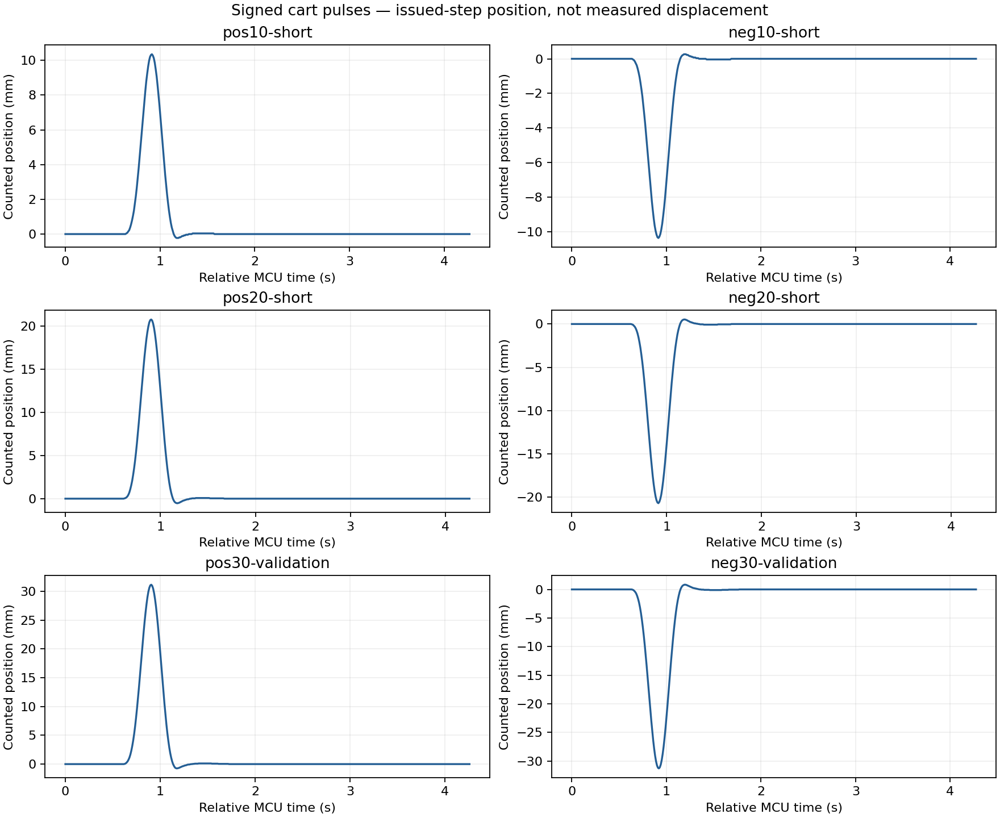

# Curated system identification evidence

This bundle contains real numeric recordings from the October 17, 2026 campaign, archived fit summaries, and reproducible diagnostic plots. **Identification remains open: no accepted plant for hardware RL transfer is supplied.** No new experiment was performed during repository creation.



## What is included

- `data/manual-*.csv`: three frozen continuous rollouts from the new manual release assessment. Each row contains MCU-relative experiment time, raw encoder angle, stored frozen-model prediction and prediction error. These are selected free-motion intervals, not the full 180 s recording. Nominal 30°/60° names describe release instructions, not calibrated starting angles.
- `data/pulse-*.csv`: four signed 10/20 mm training pulses and the reserved signed 30 mm validation pair. Time is relative to the first MCU STATE row in each recording. Position is issued-step position; velocity and acceleration are the firmware motion governor's values. They are not independent physical cart measurements. Angles are raw magnetic encoder observations; no filtering/resampling was added.
- `fits/passive-frozen.json`: conditional effective length 0.160736 m, damping 0.463156/s and local hanging-region phase −0.113109 rad. The phase is not a global encoder calibration. The fresh aggregate 0.5 s forecast p95 is 0.171106 rad, above the unchanged 0.15 rad gate; the large left release repeats the larger mismatch.
- `fits/driven-*.json`: original primary zero-phase and secondary historical-phase fits. **Both are rejected.** The secondary effective length 0.174957 m, input gain 1.40903 and damping 1.43619/s are conditional command-domain estimates, not accepted physical parameters. The favorable 0.5 s prediction score does not override failed residual and angle/input-bias diagnostics.
- `sources/hardware-excerpts.md`, `provenance.json`: original v2 paths, whole-source SHA-256 hashes, selected source excerpts and transformations. Original source filenames remain relative; no personal deployment locations or raw private logs are copied.
- `SHA256SUMS.json`: hashes of the curated numeric data, fits and source excerpts.

Four pulse files retain one repeated MCU timestamp each (pos10, neg20, pos30, neg30); these original snapshots are not silently dropped. The six pulse CSVs contain 2,806 rows in total; the three passive CSVs contain 5,555 scored samples. Each 30 mm validation trial clipped two requested command samples at the ±3 m/s² test limit. This deviation is retained here as context; CSV governor acceleration must not be replaced by an ideal reference waveform. The historic campaign reported zero logger drops/faults for these completed pulse trials. Failed earlier collections are excluded from these fitting inputs.

## Reproduce and verify

Use Python 3.10+ with NumPy and Matplotlib (verified with Matplotlib 3.10.1):

```sh
python -m pip install numpy matplotlib
python system_id/reproduce.py --output /tmp/cartpole-id-review
```

The command checks all curated data/fit/source hashes, recomputes the three continuous-rollout RMS and p95 scores from the saved arrays, verifies nondecreasing pulse times and zero fault fields, and generates the two PNG figures plus `verification.json`. It performs no network or hardware access. Running without `--output` regenerates `system_id/plots/`.

This reproduces descriptive plots and stored-prediction scoring. It does **not** rerun the original fit, MuJoCo simulator or full private recording ingestion. Full historical fitting provenance is recorded by source hashes; the v2 campaign's original tools and full recordings are required to recreate those calculations from scratch. No claim of fully reproducible parameter estimation is made for this small public export.



## Interpretation and uncertainty

Conditional regression errors are retained in each fit JSON. They omit calibration error, correlated sensor noise, manual annotation uncertainty and model bias; they must not be treated as total physical uncertainty. Cart stationarity during passive tests depended on operator hand restraint. Camera geometry coverage over the three selected releases was approximately 81.3%, 82.2%, and 88.6%; camera scale and receipt timing were diagnostic, not independently calibrated metrology. No camera images, stream addresses or host timestamps are included.

Mass, inertia, motor force authority, physical actuator delay, cart slip and full-swing/upright sensing accuracy remain unidentified. Effective pendulum length is a dynamical parameter, not a measured rod length. A single release per condition does not establish a repeatability distribution. See [`../hardware.json`](../hardware.json) for explicitly separated configured values, owner observations, fitted quantities and unknowns. These archived observations do not establish the current live rig state.
